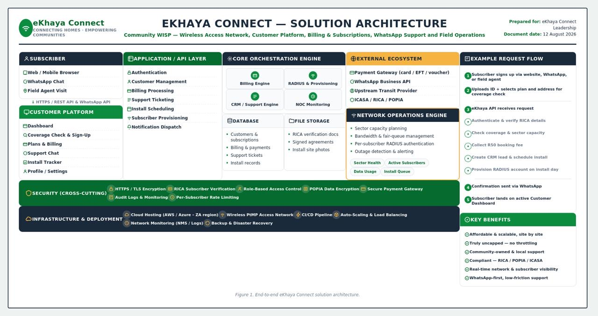
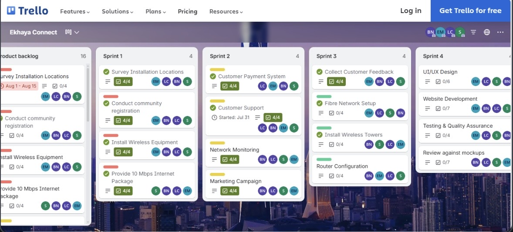
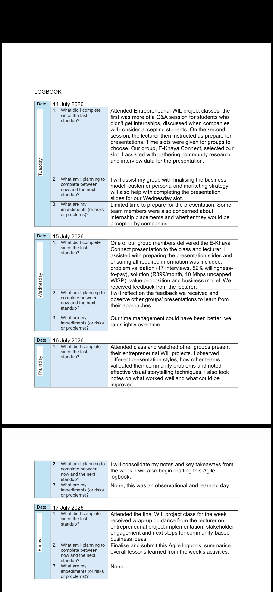
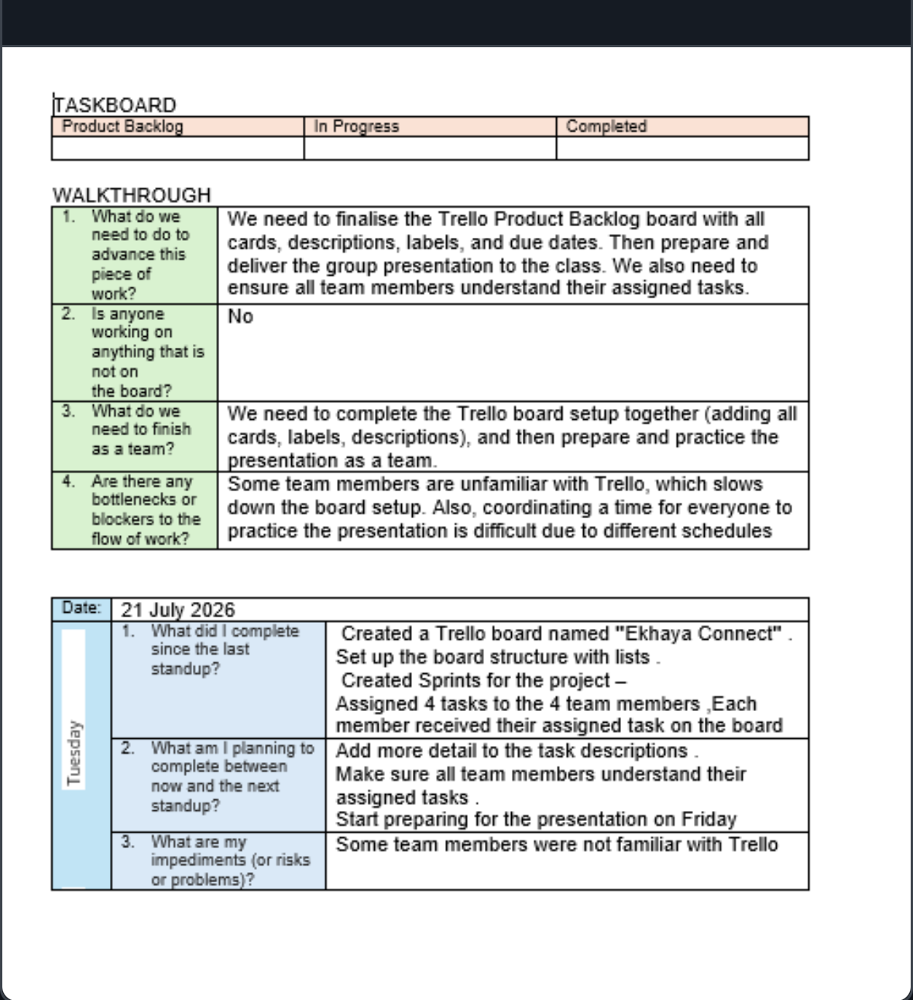
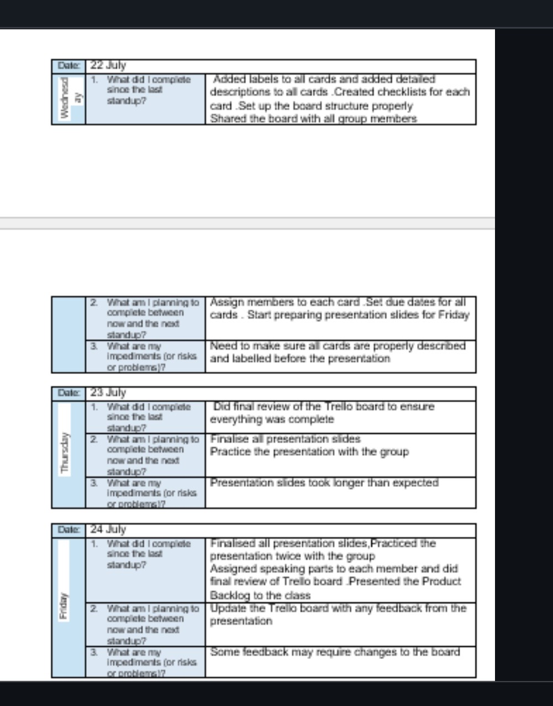
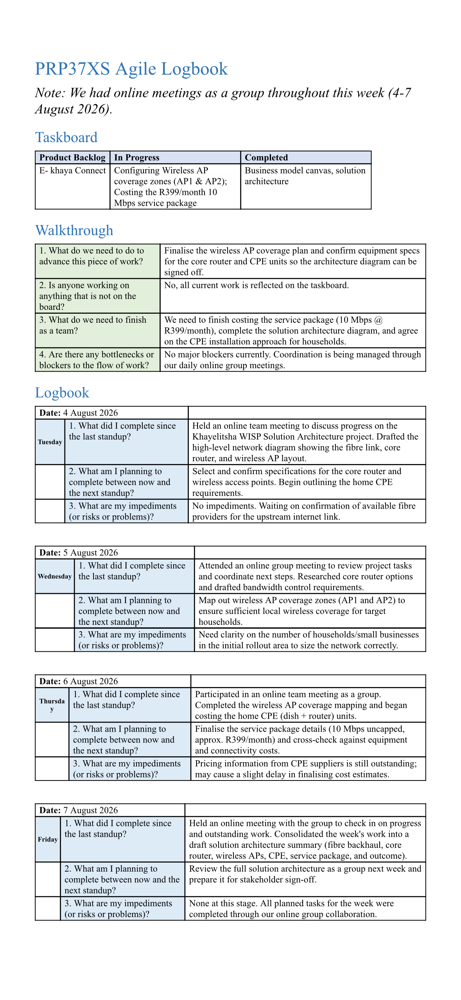

**Student Number:** 221573186  
**Module:** PRP370S - Project Presentation 3  
**Qualification:** Diploma in ICT Communication Networks  
**Institution:** Cape Peninsula University of Technology (CPUT)  
**Year:** 2026

---

## Curriculum Vitae

### Contact

- Phone: 073-847-7582
- Email: 221573186@mycput.ac.za
- Address: 10 Dorset St, Cape Town, 8001

### Professional Summary

ICT in Communication Networks student with practical experience in configuring, maintaining and troubleshooting network systems. Skilled in TCP/IP, routing, switching, VLANs, DHCP and basic network security. Seeking an opportunity in any network related IT role to apply technical skills, gain hands-on industry exposure and contribute to reliable and secure communication networks.

### Technical Skills

- LAN/WAN configuration, routing & switching
- VLANs and IP addressing
- Network security and proactive monitoring
- Hardware/software installation and maintenance (Windows & Linux)
- Network labs and troubleshooting exercises (CPUT)
- MySQL database management
- GitHub and Markdown
- Problem solving and communication

### Education

**Matric**  
Mtitara Senior Secondary School, Lady Frere  
Passed with Bachelor's Pass

**Diploma in ICT Communication Networks (In Progress)**  
Cape Peninsula University of Technology (CPUT), Cape Town  
Expected completion: 2026

### Work Experience

**Retail & Customer Service**  
Power Fashion | June 2023 - Jan 2024  
- Handled cash transactions accurately and efficiently
- Provided customer service and support
- Developed soft skills

**Store Building Assistant**  
Power Fashion | May 2023 - Jun 2023  
- Assisted in setting up store layout, displays and stock arrangement
- Worked with a team to meet deadlines
- Developed hands-on problem-solving, teamwork, and time management skills

### References

**Sinesipho Mkuyana**  
University of Fort Hare  
Phone: 083-246-3139  
Email: sinesipho.mkuyana3@gmail.com

**Rebecca Bure**  
Cape Peninsula University of Technology  
Phone: 02-460-3675  
Email: burer@cput.ac.za

---

## Mock Interview Video
 
 
---

## Reflections

### Reflection 1: Coding in Markdown  

**Situation**  
I was required to create a digital portfolio using GitHub and Markdown language for the PRP370S module.

**Task**  
I needed to design and develop a complete digital portfolio, including a CV and reflections, using Markdown syntax.

**Action**  
I researched GitHub Flavoured Markdown (GFM) documentation, practiced with headings, lists, and links, and structured my portfolio content clearly.

**Result**  
I successfully created a professional digital portfolio and gained practical skills in Markdown.

---

### Reflection 2: Mock Interview Video  

**Situation**  
As part of work readiness training, I was required to record a mock interview video.

**Task**  
I needed to answer common interview questions confidently and demonstrate professional communication skills.

**Action**  
I researched common ICT interview questions, prepared answers, and recorded multiple takes to ensure quality.

**Result**  
I created a professional interview video, improved my confidence, and added a valuable visual element to my portfolio.

---

### Reflection 3: Using GitHub Pages  
**Situation**  
I needed to publish my Markdown portfolio online so that examiners could access it.

**Task**  
I had to enable GitHub Pages, configure deployment settings, and ensure the portfolio was publicly accessible.

**Action**  
I went to Settings → Pages, selected the `main` branch, and tested the live URL.

**Result**  
I successfully published my portfolio online and learned how to host websites using GitHub Pages.

---

 
 # Ekhaya Connect: Affordable WISP Project
 # Entrepreneurial WIL Project

##  Project Overview
**The Problem:** Khayelitsha faces a severe digital divide due to major telecom companies under-investing in the area. Residents and small business owners struggle daily with a lack of affordable, reliable home internet.
**Our Solution:** *Ekhaya Connect* is a Wireless Internet Service Provider (WISP) offering uncapped 10 Mbps fixed wireless internet for approximately R399/month. By leveraging a shared high-speed fibre link and local wireless dishes, we provide affordable access without needing massive infrastructure rollouts.

##  Team Members
*   Sikhutaze Joseph
*   Bongiwe Ntwasa
*   Elam Mthwane
*   Phumelela Nzewu
*   Lilitha Nodolo

## Portfolio Index
Click the links below to view the specific Agile artifacts and reflections:

*    **[1. Agile Team Charter](./01-Agile-Project-Charter.md)**
*    **[2. User Stories & Tasks](./02-User-Stories-and-Tasks.md)**
*    **[3. Product Backlog](./03-Product-Backlog.md)**
*    **[4. Sprint Backlog](./04-Sprint-Backlog.md)**
*    **[5. Agile Logbook](./05-Agile-Logbook.md)**

##  Project Artefacts & Deliverables

### 1. The Live Website
*   **Link:** [Ekhaya Connect Live Website](https://sikhutazejoseph.github.io/khayelitsha---connect/)
*   **Reflection:** Building the live website was a major milestone. It shifted our project from a theoretical business plan into a tangible reality. I learned how to translate user stories into a real digital experience. It taught me that launching a Minimum Viable Product (MVP) is better than waiting for perfection, as it allowed us to show the community exactly what Ekhaya Connect offers.

### 2. UI/UX Wireframes
*   **Link:** [Ekhaya Connect Figma Wireframes](https://www.figma.com/design/hKfPAd7rTmUvl1RQEnLLLL/Untitled?node-id=0-1&t=KhAGD32s9aIEVIcd-1)
*   **Reflection:** Creating wireframes taught me the importance of empathy in design. We had to strip away the colors and focus purely on layout. I realized that many residents in Khayelitsha use mobile phones, so we ensured our wireframes were mobile-first. This process saved us a lot of time later, as we caught design flaws before writing a single line of code.

### 3. Brand Guide
*   **Link:** [Brand Guide](https://raw.githubusercontent.com/sikhutazejoseph/eKhaya-connect/refs/heads/main/eKhaya_Connect_Brand_Guide.pptx)
*   **Reflection:** The brand guide was a crucial learning step. It taught me that a business is more than just its product; it is an identity. We chose colors and fonts that resonate with the Khayelitsha community—aiming for a look that feels modern, trustworthy, and approachable.

### 4. Business Model Canvas
*   **Link:** [Ekhaya Connect Business Model Canvas](https://canva.link/vi2pxlhuby6cnld)
*   **Reflection:** The Business Model Canvas was the "big picture" moment for our team. It forced me to confront the financial realities of our WISP idea. By mapping out our costs against our revenue, I understood the importance of scale and customer retention.

### 5. Solution Architecture

**Description:** A comprehensive end-to-end architecture diagram mapping out the Subscriber platform, Application/API Layer, Core Orchestration Engine, Network Operations Engine, and External Ecosystem.

**Reflection:** Designing the solution architecture was a critical step in proving the technical feasibility of Ekhaya Connect. It shifted my perspective from just seeing the "business idea" to understanding the complex engine behind it. I learned how a Wireless Internet Service Provider (WISP) actually functions from the payment gateway and RADIUS provisioning, to the NOC monitoring and field agent scheduling. Mapping out the security and deployment infrastructure (like cloud hosting and CI/CD pipelines) taught me that a successful WISP requires highly coordinated software orchestration to deliver a seamless, uncapped experience to the community.

## Visual Evidence
### Trello Board (Product Backlog & Sprints)

### Agile Logbook (Daily Standups)
## WEEK 1

## WEEK 2

## WEEK 3

